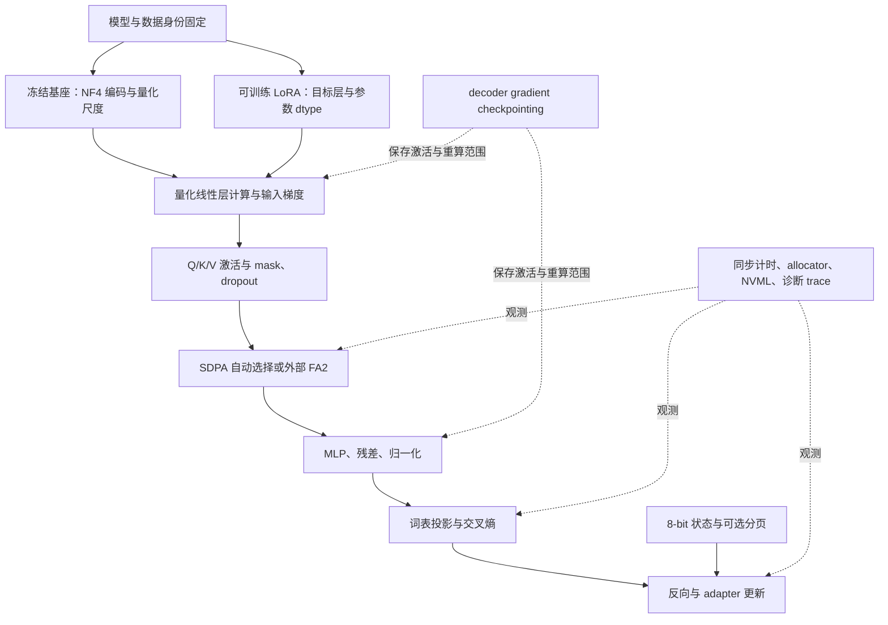

# 阅读路线与知识地图

检索日期：2026-10-24。可先完成前四步，再按实现需要进入源码和相邻研究。下列学习目标是本项目的安排；并非论文作者要求的实验流程。

## 推荐顺序

| 顺序 | 阅读入口 | 读完应能回答 |
| --- | --- | --- |
| 1 | [LoRA](https://arxiv.org/abs/2106.09685) → [QLoRA Q01/Q05/Q06](qlora.md) | 哪些参数被冻结、哪些被优化？为什么冻结权重仍需输入方向的反向？四投影与 all-linear 改变了什么？ |
| 2 | [QLoRA Q04/Q13/Q14/Q17–Q19](qlora.md) | NF4 的码本与 absmax 是什么？DQ 压缩什么？8-bit optimizer 与 paging 各压缩/管理什么？ |
| 3 | [在线 softmax](https://arxiv.org/html/1805.02867v2) → [FA F01–F04](flashattention-2.md) | 如何合并两个块的 softmax 统计？FA2 为什么改变并行分工？哪些复杂度仍是二次？ |
| 4 | [FA F09–F17](flashattention-2.md) → [工程专题](engineering-and-measurement.md) | eager、SDPA、外部 flash-attn 如何连到模型？dtype、mask、dropout、GC 分别由谁控制？ |
| 5 | [测量与 MFU 修订](project-implications.md) → [工程专题](engineering-and-measurement.md) | CUDA 同步测什么时间？allocated/reserved/NVML 有什么差别？为何重算 FLOPs 不应混入 MFU？ |
| 6 | [Triton 与官方课程 R14–R24](related-work-and-learning.md) | 如何从算子公式定位 HBM 读写、tile、warp 和 occupancy？如何用 microbenchmark 解释模型级结果？ |
| 7 | [相邻方法 R08–R13、R25–R30](related-work-and-learning.md) → [数据与指标](data-and-evaluation.md) | 哪些方法改变初始化、容量、精度或训练语义，需要单独实验？性能提升后质量如何核查？ |

## 组合机制图

图是项目工作负载的概念映射，不是特定版本的精确调用图；真实 dtype 与 kernel 要由源码和运行证据确认。对应依据见 [QLoRA 专题](qlora.md)、[FA2 专题](flashattention-2.md)。

## 自检题

1. 为什么 `requires_grad=False` 不等价于把整个基座放入 `no_grad()`？
2. 为什么 `bnb_4bit_compute_dtype=bf16` 不能证明 adapter 参数和 optimizer state 都是 bf16？
3. 一级 64 元素块的 fp32 scale 占每参数多少 bit？双重量化为何没有把 4-bit 权重再压成 2 bit？
4. 为什么“精确 attention”仍需要容差？为什么其计算量仍可能 O(S²)？
5. sliced-Q、跨 sequence 的 thread block 并行各减少或改善哪类成本？
6. 哪些输入条件会改变 SDPA/backend 选择？哪个层面证明真正执行了 FA kernel？
7. `labels=-100` 能否阻止一个样本关注另一个样本？
8. FA2 内部重算与 decoder checkpointing 的重算范围有何不同？
9. 单个 logits 张量、累计保存的激活和 allocator 峰值为什么不能直接相加？
10. 为什么 paging enabled、managed allocation、observed migration 是三种证据？
11. 为什么含重算的利用率和排除重算的 MFU 不能用同一字段混合比较？
12. 文献中的 65B/48GB、内核 TFLOP/s、训练 MFU，分别能支持什么结论，不能支持什么结论？

答案查阅各专题；在 GPU 实验前先形成文字解释，再据 trace、日志和评测核实。无需为了阅读资料立即安装所有依赖或运行所有仓库示例。
